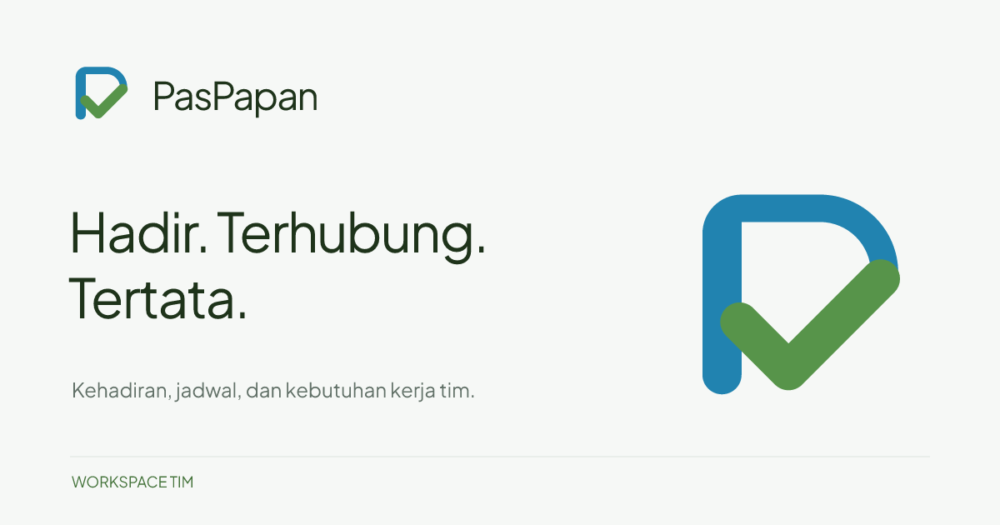
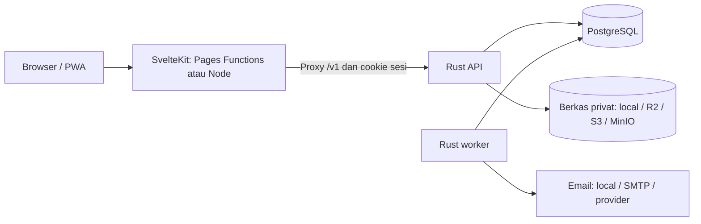

<div align="center">
  
</div>

# PasPapan

Platform operasional SDM untuk presensi GPS + QR dinamis, jadwal kerja, pengajuan, payroll, dan administrasi perusahaan. Frontend memakai **SvelteKit 3 / Svelte 5**, backend **Rust / Axum**, dan data disimpan di **PostgreSQL**.

Repository ini berisi hasil rewrite Rust + Svelte. PHP/Laravel dan Capacitor bukan runtime aplikasi saat ini. Cakupan implementasi dan batas migrasi historis dicatat di [rewrite parity](guides/rewrite-parity.md).

## Mulai dari sini

- **Ingin mencoba lokal?** Ikuti [setup lokal](#menjalankan-lokal).
- **Admin/pengguna baru?** Baca [urutan pemakaian](#urutan-pemakaian).
- **Ingin deploy?** Mulai dari [topologi production](#deployment-production), lalu [runbook deployment](guides/deployment.md).
- **Mengembangkan fitur?** Lihat [struktur repository](#struktur-repository), [pengujian](#pengujian), dan [panduan desain](guides/ui/DESIGN-SYSTEM.md).

## Kegunaan dan halaman utama

| Kebutuhan | Halaman | Perilaku utama |
| --- | --- | --- |
| Presensi karyawan | `/app/today`, `/app/scan`, `/app/history` | Check-in/out, QR kedaluwarsa, validasi radius GPS, riwayat pribadi |
| Pola jam kerja | `/admin/attendance` | Master shift harian/lintas hari |
| Penjadwalan | `/admin/schedules`, `/app/schedule` | Penetapan shift perusahaan dan jadwal pribadi |
| Pengajuan | `/app/requests`, `/app/approvals` | Cuti, lembur, koreksi presensi, klaim, kasbon, WFH, tukar shift; keputusan berjenjang |
| Karyawan dan akses | `/admin/employees`, `/admin/access` | Direktori, status kerja, atasan langsung, custom role dan grant/deny |
| Payroll | `/admin/payrolls`, `/app/payroll` | Periode, kalkulasi terkonfigurasi, publikasi slip, snapshot rekening, ekspor bank |
| Operasional HR | `/admin/hr-documents`, `/admin/hr-checklists`, `/admin/kpi` | Dokumen/template, checklist, target dan evaluasi kinerja |
| Aset dan komunikasi | `/admin/assets`, `/admin/announcements` | Penugasan/pengembalian aset, pengumuman dan status baca |
| Dashboard | `/admin/dashboard` | Tren presensi, antrean, traffic API, kesehatan database, error API dan audit sesuai izin |
| Integrasi | `/admin/integrations` | Owner mengelola provider, endpoint, kredensial terenkripsi dan aktivasi |
| Akun pribadi | `/user/profile` | Profil, kata sandi, sesi perangkat, bahasa ID/EN dan tema sistem/terang/gelap |

Menu **Workspace** dan **Admin** memakai URL terpisah. Menu yang terlihat mengikuti capability pengguna; API tetap memeriksa izin meskipun endpoint dipanggil langsung.

### Batas fitur yang perlu dipahami

- Provider biometrik/tanda tangan harus dikonfigurasi dan mendukung adapter `signed_bridge_v1`. Gerakan wajah dari browser saja bukan bukti verifikasi server. Lihat [integrasi provider](guides/provider-integrations.md).
- Aturan payroll dan format ekspor bank harus disiapkan perusahaan. Ekspor CSV **bukan transfer otomatis** ke bank.
- Worker wajib berjalan untuk tugas latar belakang, termasuk pengumuman terjadwal dan outbox email. `MAIL_DRIVER=local` menulis email ke spool; tidak mengirimnya ke inbox internet.
- Traffic dashboard adalah request API terautentikasi pada proses berjalan, bukan pengunjung Cloudflare. Data di memori direset saat restart. Lihat [definisi telemetry](guides/dashboard-telemetry.md).
- Migrasi skema rewrite berbeda dengan impor data Laravel. Alat [preflight legacy](guides/legacy-data-migration.md) hanya membaca sumber; belum melakukan impor data historis.

## Arsitektur dan pembagian service



| Service | Tugas | Tempat berjalan |
| --- | --- | --- |
| `web` | UI, bahasa/tema, proxy API pada origin yang sama | Lokal `:4173`; production Cloudflare Pages + Functions |
| `api` | Autentikasi, RBAC, validasi domain, transaksi dan file privat | Lokal/VPS `127.0.0.1:3000` |
| `worker` | Memproses pekerjaan database secara berkala | Proses/container terpisah, memakai database API yang sama |
| PostgreSQL | Sesi, anggota perusahaan, presensi, payroll, audit, outbox | Disediakan terpisah; **tidak dibuat oleh `compose.yaml`** |
| Object storage | Foto/lampiran/dokumen privat | Volume persisten atau bucket yang dikonfigurasi |

Browser mengakses `/v1/*` melalui domain FE. Proxy menyisipkan `API_INTERNAL_KEY` di server; key ini tidak perlu diketahui browser. API memakai cookie sesi, pemeriksaan Origin untuk mutasi, dan pembatasan `company_id`.

## Struktur repository

```text
apps/
  web/
    src/routes/          Halaman SvelteKit, layout dan routing
    src/lib/             UI bersama, modul fitur, sesi, i18n dan tema
    src/hooks.server.ts  Proxy server FE ke API + middleware bahasa
    static/              Logo, ikon PWA dan font Jakarta Sans lokal
    messages/            Pesan ID/EN Paraglide
    tests/               Tes akses, desain, aset dan PWA
    wrangler.jsonc       Konfigurasi adapter Cloudflare Pages
  api/
    src/main.rs          Router, autentikasi dan bootstrap API
    src/access*.rs       Evaluasi capability dan pengaturan akses
    src/people.rs        Direktori dan status karyawan
    src/traffic.rs       Telemetry API per perusahaan
    src/                 Modul domain: presensi, payroll, HR, aset, provider
    src/bin/             CLI migrate dan seed_local
    migrations/          Migrasi SQL rewrite berversi
    tests/               Pengujian HTTP, RBAC dan isolasi tenant
  worker/src/main.rs     Worker outbox dan pengumuman terjadwal
crates/
  contracts/             DTO request/response bersama
  domain/                Tipe identitas tenant/actor dan base role
  application/           Fondasi use-case/port; belum memuat seluruh logika
  adapters/              SQLx, pembaca env, storage dan mailer
scripts/                 Runner lokal, Podman, pengujian dan preflight legacy
guides/                  Panduan teknis dan operasional
assets/brand/            Sumber identitas visual
compose.yaml             API + worker + web untuk lingkungan container
```

Sebagian besar logika domain saat ini masih berada di modul `apps/api/src/`. Folder `crates/application` dan `crates/domain` adalah fondasi pemisahan, bukan klaim bahwa semua handler sudah dipindahkan ke lapisan tersebut.

## Menjalankan lokal

Semua perintah berikut dijalankan dari **root repository**, kecuali blok yang menyebut lokasi lain.

### 1. Prasyarat

- Git, **Bun ≥ 1.3.6**, **Node.js ≥ 24**, Rust stable dan Cargo. Metadata Rust menetapkan minimal 1.89; gunakan toolchain yang mendukung `Cargo.lock` saat ini.
- PostgreSQL yang dapat diakses serta CLI `psql`/`createdb`. Pengembangan memakai PostgreSQL 18; deployment yang ada juga menjalankan PostgreSQL 17.
- Podman + penyedia Compose hanya diperlukan untuk opsi container.

Pada Mac Apple Silicon, terminal dan toolchain harus memakai arsitektur yang sesuai. Error `libxcrun ... need x86_64` dengan library ARM menunjukkan ketidakcocokan toolchain/terminal, bukan error koneksi database.

### 2. Instal dependensi dan siapkan env

```bash
git clone https://github.com/RiprLutuk/PasPapan.git
cd PasPapan
git switch rewrite/svelte-rust
bun install
bun install --cwd apps/web --frozen-lockfile
```

Salin contoh env **hanya jika file tujuan belum ada**:

```bash
test -f apps/api/.env || cp apps/api/.env.example apps/api/.env
test -f apps/web/.env || cp apps/web/.env.example apps/web/.env
chmod 600 apps/api/.env apps/web/.env
```

Edit `apps/api/.env` agar menunjuk database rewrite tersendiri. Contoh untuk PostgreSQL lokal tanpa password:

```dotenv
DATABASE_URL=postgres://postgres@127.0.0.1:5432/paspapan_rewrite
API_BIND=127.0.0.1:3000
APP_ORIGIN=http://127.0.0.1:4173,http://localhost:4173
SESSION_COOKIE_SECURE=false
AUTO_MIGRATE=true
STORAGE_DRIVER=local
STORAGE_LOCAL_ROOT=./var/objects
MAIL_DRIVER=local
MAIL_LOCAL_SPOOL=./var/mail
```

Sesuaikan user, password dan port dengan PostgreSQL Anda, misalnya port `1921`. `DATABASE_URL` adalah konfigurasi yang dibaca Rust; variabel Laravel `DB_HOST`, `DB_PORT`, dan `DB_DATABASE` tidak dikonversi otomatis. Jangan arahkan migrasi rewrite ke database Laravel sumber.

Buat database jika belum ada, memakai host/port/user yang sama dengan `DATABASE_URL`:

```bash
createdb -h 127.0.0.1 -p 5432 -U postgres paspapan_rewrite
```

Pastikan env FE menunjuk API lokal:

```dotenv
# apps/web/.env
WEB_HOST=127.0.0.1
WEB_PORT=4173
ORIGIN=http://127.0.0.1:4173
API_PROXY_TARGET=http://127.0.0.1:3000
```

Isi `API_INTERNAL_KEY` yang **sama** pada env API dan FE. `SESSION_SECRET` hanya di API. Nilai contoh pada `.env.example` diperuntukkan lokal; ganti dengan nilai acak untuk production. Variabel environment shell mengalahkan nilai file env.

### 3. Migrasi, akun lokal dan startup

```bash
cargo run -p paspapan-api --bin migrate

# Opsional, hanya pada database lokal:
cargo run -p paspapan-api --bin seed_local

# Menjalankan API, worker dan FE sekaligus:
bun run dev:services
```

Buka **http://127.0.0.1:4173**. Health API: **http://127.0.0.1:3000/health**. Hentikan ketiga service dengan `Ctrl+C`.

Jangan hanya membuka server API dan mengharapkan UI muncul. FE berjalan di port 4173. Jika memakai perintah service manual, perhatikan working directory: path storage/mail relatif mengikuti direktori proses. Runner `dev:services` menjalankan API/worker dari `apps/api`.

| Akun seed lokal | Email | Password | Base role |
| --- | --- | --- | --- |
| Pemilik | `superuser@local.test` | `superuser-local` | `owner` |
| Admin | `admin@local.test` | `admin-local-123` | `admin` |
| Karyawan | `user@local.test` | `user-local-123` | `employee` |

Akun di atas dibuat oleh `seed_local`, bukan akun bawaan semua instalasi atau jaminan akses demo publik. Seed tidak mereset password akun yang sudah ada. **Jangan jalankan seed lokal pada database production.** Tanpa seed, gunakan registrasi workspace untuk membuat pemilik pertama.

### Opsi: Podman

```bash
bun run podman:init
# Edit env API/FE dan pastikan database dapat dijangkau dari container.
bun run podman:up
bun run podman:status
bun run podman:logs
bun run podman:down
```

Compose menjalankan **API, worker dan web**, memakai PostgreSQL yang sudah tersedia. `127.0.0.1` dari dalam container menunjuk container itu sendiri. Petunjuk jaringan ada di [deployment](guides/deployment.md#opsi-lokal-dengan-podman-compose).

## Urutan pemakaian

### Pemilik / pengelola perusahaan

1. Daftarkan workspace dan login. Istilah superuser pada akun lokal berarti **owner perusahaan**, bukan administrator global seluruh tenant.
2. Isi master data organisasi dan data karyawan. Atur atasan langsung pada profil karyawan.
3. Delegasikan capability melalui **Admin → Peran & Izin**. Akun karyawan baru mempunyai base role `employee`; custom role mengatur izin efektif, bukan promosi otomatis menjadi owner.
4. Buat master shift, lalu tetapkan kalender karyawan. Buat lokasi kerja, koordinat dan radius di **Lokasi & QR**.
5. Tampilkan layar QR yang terus diperbarui pada lokasi kerja. Token berlaku 30 detik; jangan memakai screenshot lama sebagai media presensi permanen.
6. Proses pengajuan pada tahap manager lalu admin. Sistem menolak persetujuan pengajuan sendiri. Cakupan manager mengikuti bawahan langsung kecuali diberi izin cakupan perusahaan.
7. Sebelum payroll dipublikasikan, periksa aturan, rincian, rekening dan format bank. Publikasi mengunci riwayat tertentu dan menyimpan snapshot; jangan memperlakukan periode final sebagai draft bebas edit.
8. Aktifkan provider biometrik/tanda tangan melalui **Integrasi layanan** bila adapter dan kredensialnya siap. Master key disiapkan sekali di server; pengelolaan provider berikutnya dilakukan lewat panel owner.

### Karyawan

1. Login, periksa profil, jadwal dan lokasi kerja yang berlaku.
2. Saat presensi, izinkan kamera/lokasi, pindai QR yang masih aktif dan tunggu hasil validasi server. Akurasi lokasi bergantung perangkat serta lingkungan; memuat ulang tidak menjamin angka akurasi membaik.
3. Kirim izin/koreksi/klaim lewat Pengajuan dan pantau statusnya. Tukar shift memerlukan persetujuan rekan sesuai alur aplikasi.
4. Lihat slip yang sudah dipublikasikan. Kelola bahasa, tema, kata sandi dan sesi perangkat lewat profil.

### Ringkasan aturan akses

| Base role | Akses bawaan |
| --- | --- |
| `owner` | Seluruh capability perusahaan, termasuk akses dan konfigurasi khusus owner |
| `admin` | Operasional luas termasuk payroll; tidak mendapat pengelolaan akses/provider/kebijakan khusus owner |
| `manager` | Inbox persetujuan dan keputusan tahap manager dalam cakupannya |
| `employee` | Data dan layanan pribadi; tanpa capability administratif bawaan |

Custom role menggantikan izin bawaan; grant menambah izin dan **deny mengalahkan grant/role**. Hak owner dilindungi. Untuk HR/finance dengan akses terbatas, gunakan custom role alih-alih memberikan akses admin luas. Rincian: [audit RBAC](guides/rbac-audit.md).

## Deployment production

Topologi yang dipakai saat ini:

| Komponen | Tujuan |
| --- | --- |
| FE | [paspapan.pages.dev](https://paspapan.pages.dev) |
| Domain kustom FE | [paspapan.demo.pandanteknik.com](https://paspapan.demo.pandanteknik.com) |
| BE | VPS, dipublikasikan lewat `https://api.paspapan.pandanteknik.com` |
| Database, worker dan storage lokal | VPS / layanan privat yang dikonfigurasi |

**FE di Pages tidak membutuhkan container web pada VPS.** Pages Functions meneruskan `/v1/*` ke API VPS. Build harus memakai adapter Cloudflare beserta output Functions, bukan mengunggah aset statis saja.

Konfigurasi Pages yang direkomendasikan untuk monorepo ini:

| Pengaturan | Nilai |
| --- | --- |
| Production branch | `rewrite/svelte-rust` |
| Root directory | `apps/web` |
| Build command | `bun install --frozen-lockfile && bun run build` |
| Build output | `.svelte-kit/cloudflare` |
| Build environment | `ADAPTER=cloudflare`, Node 24, Bun sesuai versi repository |
| Runtime variable | `API_PROXY_TARGET=https://api.paspapan.pandanteknik.com` |
| Runtime secret | `API_INTERNAL_KEY`, sama dengan API VPS |

Pada API, `APP_ORIGIN` berisi origin FE yang diizinkan; `SESSION_COOKIE_SECURE=true` pada HTTPS. Database, mailer dan credential storage **tidak ditaruh di env publik FE**.

Langkah lengkap build, bootstrap key, deploy API/worker, pemasangan domain, backup dan rollback: **[runbook deployment](guides/deployment.md)**.

### CI/CD: yang otomatis dan yang belum

- `.github/workflows/ci.yml` berisi pemeriksaan Rust dan FE pada push/PR, bukan job deployment VPS.
- Git integration Pages membangun FE saat branch production dipush, jika integrasi proyek Cloudflare aktif. Keberhasilan push tidak membuktikan build sudah selesai.
- Deployment BE saat ini dilakukan terpisah memakai image dengan tag commit dan verifikasi health. Jangan menganggap push GitHub otomatis memperbarui VPS.
- Untuk perubahan kontrak API, jaga kompatibilitas selama rollout dan periksa versi FE **serta** image API/worker.

## Pengujian

```bash
cargo fmt --check --all
cargo clippy --workspace --all-targets -- -D warnings
cargo test --workspace
bun run check
bun run test:web
bun run build                         # Adapter Node
ADAPTER=cloudflare bun run build      # Adapter Cloudflare
```

Pengujian integrasi memerlukan service lokal aktif dan database khusus bernama `paspapan_rewrite`:

```bash
bun run dev:services
# Jalankan di terminal lain:
bun run test:integration
```

Suite membuat dan membersihkan fixture miliknya sendiri. Jangan arahkan ke production atau sumber Laravel. Tes receipt provider memakai bukti khusus pengujian; itu bukan sertifikasi vendor sebenarnya.

## Troubleshooting

| Gejala | Yang diperiksa |
| --- | --- |
| `untrusted request origin` | Origin browser harus diizinkan `APP_ORIGIN` API; jangan menambahkan path `/login` pada origin |
| Login gagal / proxy 403 | `API_INTERNAL_KEY` FE runtime dan API harus sama; periksa juga Cloudflare Access |
| `/v1/*` 404 di Pages | Adapter/output Functions dan `API_PROXY_TARGET`; jangan hanya deploy file statis |
| 404 pada `/cdn-cgi/access/authorized` | Konfigurasi aplikasi/domain Cloudflare Access; bukan route login PasPapan |
| API 502 | API VPS belum sehat, target proxy salah, atau jalur Tunnel/reverse proxy terputus |
| Database tidak terhubung | `DATABASE_URL`, port, user, nama database, dan alamat dari jaringan container |
| Email tidak sampai | Worker aktif dan driver bukan `local`; periksa konfigurasi provider mail |
| Provider tidak bisa diaktifkan | Master key server dan kredensial/adapter yang sesuai; konfigurasi kosong menolak verifikasi |
| Peta menampilkan `Access blocked` | Request tile harus mengirim Referer origin; periksa kebijakan peta atau ekstensi privasi browser |
| UI belum berubah | Pastikan deployment Pages benar-benar sukses, versi domain sama, lalu reload; jangan cache HTML/API privat |

## Dokumentasi lanjutan

- [Indeks panduan](guides/README.md)
- [Arsitektur](guides/architecture.md) · [fitur dan endpoint](guides/features.md)
- [Deployment](guides/deployment.md) · [storage dan operasional](guides/operations.md)
- [Integrasi provider/payroll](guides/provider-integrations.md) · [telemetry dashboard](guides/dashboard-telemetry.md)
- [RBAC](guides/rbac-audit.md) · [keamanan](guides/security-checklist.md)
- [Status parity rewrite](guides/rewrite-parity.md) · [migrasi legacy](guides/legacy-data-migration.md)
- [Desain UI](guides/ui/DESIGN-SYSTEM.md) · [identitas visual](assets/brand/README.md)

## Dukungan dan lisensi

Dikembangkan oleh [RiprLutuk](https://github.com/RiprLutuk). Jika PasPapan membantu tim Anda, dukungan pengembangan dapat diberikan melalui GoPay berikut.

<div align="center">
  
  <p>Dukungan pengembangan melalui GoPay</p>
</div>

Lihat [LICENSE](LICENSE), yang memuat MIT. Metadata `license` pada workspace Rust masih bertuliskan `proprietary`; keduanya belum diselaraskan.

### Session dan halaman error

Sesi berakhir setelah 30 menit tanpa interaksi atau maksimal 8 jam sejak login. Reload tidak menghapus sesi yang masih valid. Pengaturan, alur auto logout, dan pengujian dijelaskan di [panduan sesi dan error](guides/sessions-and-errors.md).
