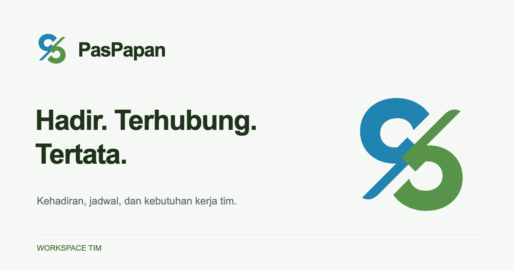

> Branch rewrite: Rust API + Svelte/PWA sedang dimigrasikan. Wrapper Capacitor Android/iOS sudah dihentikan; native client akan dikembangkan terpisah melalui API. Lihat [status migrasi](./guides/rewrite/STATUS.md). Fitur Laravel di bawah belum semuanya tersedia di rewrite.

<div align="center">



# PasPapan: Revolusi HRIS & Operasional Perusahaan Anda

**Sistem HRIS All-in-One Terlengkap di Indonesia** yang dirancang khusus untuk membebaskan Anda dari kerumitan *spreadsheet* manual. PasPapan menghadirkan solusi *self-hosted* canggih mulai dari **Absensi Face ID & GPS akurat**, otomatisasi **Payroll & Slip Gaji PDF**, pengelolaan **Cuti/Lembur/WFH**, **Kasbon & Reimbursement**, hingga pantauan **Operasional Lapangan**. Akses mobile tersedia melalui browser/PWA.

[](https://github.com/RiprLutuk/PasPapan/releases/tag/v5.0.2)
[](./guides/deployment.md)
[](#open-source--enterprise)

</div>

PasPapan diciptakan bagi perusahaan modern yang ingin memusatkan seluruh aktivitas harian HR, Finance, Manager, dan Tim Operasional ke dalam satu platform eksklusif yang bisa dikontrol sendiri 100%. Sangat direkomendasikan bagi tim yang lelah menggunakan WhatsApp, tumpukan kertas form terpisah, dan perhitungan gaji Excel yang rentan *human-error*.

Dengan PasPapan, karyawan menikmati kemudahan *mobile experience* premium untuk absen *selfie*, klaim *reimbursement*, hingga cek sisa cuti. Di sisi lain, HR dan Manajemen memiliki *dashboard* analitik *real-time* untuk memantau produktivitas, mengunci radius absen GPS, mendeteksi kecurangan (*anti-mock location*), serta mengeksekusi *payroll* dengan sekali klik!

## Yang Bisa Dikerjakan

| Area | Fitur Utama |
| --- | --- |
| HR & Karyawan | Database karyawan lengkap, struktur divisi/jabatan/level, rantai persetujuan (*direct manager*), kontrak & probation, dokumen privat, checklist *onboarding/offboarding* |
| Absensi Pintar | Validasi GPS Akurat, Face ID Liveness, Foto *Selfie*, Barcode/Dynamic QR Scanner, *Offline Submission*, **Fraud Risk Scoring** (Anti-Mock Location) |
| Shift & Jadwal | *Visual Shift Planning* (Kalender), *Drag-and-Drop Roster*, Deteksi Bentrok Jadwal, Kalender Libur Nasional, hingga Tukar Shift Antar Karyawan (*Shift Swap*) |
| Approval Harian | Cuti, Izin, Lembur, *Work From Home* (WFH), Reimbursement, Kasbon, dan Koreksi Absensi dengan alur multi-level approval |
| Payroll & Finance | *One-Click Payroll* (periode bulanan/harian), Komponen Gaji Kustom, Integrasi BPJS & PPh21 / Coretax, THR Prorata, *Payment Instruction*, hingga Cetak Slip Gaji PDF |
| Reimburse & Kasbon | Siklus pengajuan hingga pelunasan, pencairan dana, lampiran kuitansi privat, pantauan *aging*, dan rekapitulasi pengeluaran per divisi |
| Operasional Lapangan | CRM Ringan (Client & Project), Penugasan (*Task*), Bukti Kunjungan Lapangan GPS & Foto, Manajemen Aset dengan QR Tagging, Katalog Produk & Stok |
| Kolaborasi Tim | *Collaboration Workspace*: Chat Terenkripsi (Personal/Grup/Proyek), *Secure File Sharing*, hingga Pengikatan Link Meeting (Zoom/Google Meet/Teams) |
| Commercial & Invoice | Modul Akuntansi Lengkap: Cetak *Quotation* & *Invoice*, *Vendor Bill*, *Journal/Ledger*, *Chart of Accounts*, *Cashflow*, hingga Pemantauan AR/AP Aging |
| Laporan & Analytics | **Admin Dashboard Gahar**: Analitik *Real-time* interaktif, Penilaian Performa/KPI, hingga Ekspor Laporan Excel/PDF super lengkap |
| Security & Maintenance | Hak Akses (RBAC) granular, *Audit Trail*, *Custom Form Builder*, Isolasi Data Multi-Cabang, *Operational Health Dashboard*, hingga **Pusat Backup & Restore Otomatis** |
| Data Management | Modul *Export & Import Background* (Ekspor ribuan data tanpa takut *Timeout/Loading* lama), serta *System Cleanup Tools* untuk menjaga storage tetap lega |
| Mobile Web / PWA | Akses melalui browser dan PWA. Build native terpisah belum tersedia pada branch rewrite. |

Detail lengkap ada di [guides/features.md](./guides/features.md).

## Add-On Premium

PasPapan memakai model **core + add-on**. Core HRIS, absensi, approval, operasional, finance, dan reporting tetap menjadi fondasi utama. Fitur add-on enterprise dibuka melalui license entitlement dan RBAC, sehingga perusahaan bisa mengaktifkan modul berbayar sesuai kebutuhan tanpa memecah login, company scope, payroll, atau accounting ke aplikasi terpisah.

| Add-on | Cakupan | Status |
| --- | --- | --- |
| **Toko/POS Premium** | Dashboard toko, POS kasir, produk/barcode, pelanggan, vendor/pembelian, inventory, retur, quotation, surat jalan, cash & payment, report retail, dan migrasi master data via template CSV. Route utama: `/admin/toko`, `/admin/toko/pos`, `/admin/toko/products`, `/admin/toko/customers`, `/admin/toko/purchases`, `/admin/toko/inventory`, `/admin/toko/reports`. | Add-on enterprise dengan entitlement `toko_pos`; baseline code siap UAT/cutover dan tetap dikunci license + permission `admin.toko_pos.*`. |
| **Enterprise Operations** | Audit/risk scoring, analytics dashboard, backup/restore, operational health, import/export background, document workflow, asset/appraisal, dan payroll lanjutan sesuai entitlement license. | Aktif sesuai fitur yang tertera di license enterprise. |

Migration Toko/POS memakai template CSV yang sudah ditentukan untuk `products`, `customers`, `vendors`, `categories`, dan `brands`. Halaman `/admin/toko/migration` hanya untuk head/import-level dan bisa dimatikan setelah cutover dengan setting `toko_pos.migration_enabled=false`.

Dokumen add-on ada di [premium-toko-pos-addon.md](./guides/premium-toko-pos-addon.md), PRD ada di [premium-toko-pos-prd.md](./guides/premium-toko-pos-prd.md), dan checklist cutover ada di [premium-toko-pos-task-tracking.md](./guides/premium-toko-pos-task-tracking.md).

## Kenapa Dipakai

- **Satu Ekosistem Lengkap (All-in-One)**: Lupakan langganan mahal ke banyak aplikasi. Absensi, pengajuan cuti, perhitungan *payroll*, hingga pencatatan aset operasional ada di satu atap.
- **Didesain Sempurna untuk Kebijakan Indonesia**: Mengerti kebutuhan lokal! Mulai dari pengaturan PPh21, BPJS Kesehatan/TK, THR prorata, kasbon karyawan, hingga format slip gaji standar Disnaker.
- **Anti-Kecurangan (Fraud-Proof) & Siap Lapangan**: Menggunakan validasi GPS presisi tinggi, Face ID, *anti-mock location*, dan *Dynamic QR* untuk memastikan absensi selalu sah.
- **Kemananan Privasi & Data Eksklusif**: Data Anda bukan komoditas. Fitur *self-hosted*, *attachment private*, dan isolasi *multi-company* memastikan data perusahaan tetap aman di *server* Anda sendiri.
- **Browser / PWA**: Akses dari desktop dan smartphone; tidak memerlukan wrapper Capacitor.
- **Tumbuh Bersama Komunitas**: Versi *open-source* yang ramah diakses, siap digunakan sebagai basis (baseline) tanpa perlu khawatir kunci akses *enterprise* pihak ketiga.

## Cocok Untuk

- UMKM yang butuh aplikasi absensi karyawan dan pengajuan harian.
- Perusahaan multi-cabang yang perlu kontrol HR, approval, dan laporan.
- Tim lapangan yang butuh absensi GPS, foto, QR, dan bukti kunjungan.
- Finance yang ingin menyiapkan payroll, slip gaji PDF, reimbursement, kasbon, dan laporan dengan lebih rapi.
- Vendor atau konsultan yang ingin baseline HRIS Laravel yang bisa dikembangkan lebih jauh.

## Live Demo

Anda dapat mencoba PasPapan secara langsung melalui tautan demo berikut:

- **URL:** [https://paspapan.pandanteknik.com](https://paspapan.pandanteknik.com)

**Akun Akses Demo:**
- **Demo Admin:** `admin123@paspapan.com` / `12345678`
- **Demo Karyawan:** `user123@paspapan.com` / `12345678`

*(Catatan: Akun demo ini dibatasi untuk tidak dapat melakukan aksi destruktif atau mengubah pengaturan sistem).*

## Deployment

`main-vps` adalah jalur utama dan default untuk fitur lengkap. Target terbaiknya adalah VPS dengan database production, queue worker, scheduler, private storage, backup, dan optional realtime.

| Target | Rekomendasi |
| --- | --- |
| VPS | Jalur utama untuk production penuh |
| Shared hosting | Legacy/best-effort untuk instalasi ringan |
| Serverless/Vercel | Demo atau staging ringan, bukan production penuh |

Panduan lengkap ada di [guides/deployment.md](./guides/deployment.md) dan [guides/operations.md](./guides/operations.md).

## Mulai Cepat

```bash
git clone https://github.com/RiprLutuk/PasPapan.git
cd PasPapan

composer install
bun install
cp .env.example .env
php artisan key:generate
php artisan migrate
php artisan paspapan:seed-real
php artisan storage:link
```

Jalankan lokal:

```bash
php artisan serve
bun run dev
```

Untuk data demo/staging:

```bash
php artisan paspapan:seed-fake
```

Catatan: `paspapan:seed-real` untuk master data production-ready. `paspapan:seed-fake` untuk demo/QA dan tidak disarankan untuk production.

## Rilis

Rilis Laravel historis (APK di bawah bukan build branch rewrite): [`v5.0.2`](https://github.com/RiprLutuk/PasPapan/releases/tag/v5.0.2)

- APK: [`PasPapan-v5.0.2.apk`](https://github.com/RiprLutuk/PasPapan/releases/download/v5.0.2/PasPapan-v5.0.2.apk)
- Checksum: [`PasPapan-v5.0.2.apk.sha256`](https://github.com/RiprLutuk/PasPapan/releases/download/v5.0.2/PasPapan-v5.0.2.apk.sha256)
- Changelog: [CHANGELOG.md](./CHANGELOG.md)

Branch default dan fitur paling lengkap: [`main-vps`](https://github.com/RiprLutuk/PasPapan/tree/main-vps)

## Dokumentasi

Mulai dari [guides/README.md](./guides/README.md) untuk mencari dokumen yang tepat.

Dokumen penting:

- [Fitur produk](./guides/features.md)
- [Deployment](./guides/deployment.md)
- [Operasi harian](./guides/operations.md)
- [Security model](./guides/security-model.md)
- [Database portability](./guides/database-portability.md)
- [Attendance integration API](./guides/attendance-integration.md)
- [Feature maturity](./guides/feature-maturity.md)
- [Reviewer evidence](./guides/reviewer-evidence.md)
- [Premium Toko/POS add-on](./guides/premium-toko-pos-addon.md)
- [PRD Premium Toko/POS](./guides/premium-toko-pos-prd.md)

## Open Source & Enterprise

Repository open source harus bisa `composer install` dan boot tanpa `ENTERPRISE_OBFUSCATOR_KEY`.

Fitur enterprise tertentu dapat dikunci dengan license dan artifact obfuscated salted. `ENTERPRISE_LICENSE_KEY` dipakai untuk validasi fitur, sedangkan `ENTERPRISE_OBFUSCATOR_KEY` hanya untuk runtime artifact enterprise yang memang dibuild dengan proteksi tersebut.

Panduan packaging ada di [guides/enterprise-packaging.md](./guides/enterprise-packaging.md).

## Kontribusi

Baca [CONTRIBUTING.md](./CONTRIBUTING.md), [SECURITY.md](./SECURITY.md), dan [CODE_OF_CONDUCT.md](./CODE_OF_CONDUCT.md).

## Dukung Pengembangan

Kalau project ini membantu tim Anda dan Anda ingin mendukung pengembangannya, silakan scan QR GoPay berikut.

<div align="center">
  
  <p><strong>GoPay Support</strong></p>
</div>

## Kredit

[RiprLutuk](https://github.com/RiprLutuk).
