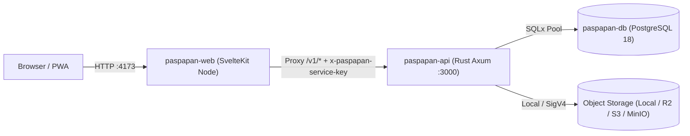

# Arsitektur Sistem PasPapan

PasPapan menggunakan arsitektur **Service Terpisah (Separated Frontend & Backend Services)** yang dikemas dengan container **Podman Machine**:

## 1. Struktur Monorepo

- **`apps/web/`**: Aplikasi frontend SvelteKit 3 (Svelte 5 Runes) dengan `@sveltejs/adapter-node`.
  - Menggunakan `src/hooks.server.ts` (di production) dan proxy Vite (di development) untuk meneruskan permintaan `/v1/*` dan `/health` ke `API_PROXY_TARGET` sambil menyisipkan header internal `x-paspapan-service-key` (`API_INTERNAL_KEY`).
- **`apps/api/`**: Server HTTP Rust berbasis Axum 0.8.
  - `src/main.rs`: Router utama, verifikasi *constant-time* `API_INTERNAL_KEY`, autentikasi Argon2id, sesi HMAC-SHA256 (`SESSION_SECRET`), absensi, shift, dan pengajuan.
  - `src/attendance_locations.rs`: Manajemen lokasi kerja & rotasi Dynamic QR 30 detik + validasi jarak Haversine.
  - `src/people.rs`: Direktori karyawan, manajemen status kerja, dan hirarki atasan langsung.
  - `src/access.rs` & `src/access_admin.rs`: Evaluasi capability RBAC kustom, grant/deny per anggota, dan audit akses.
  - `src/account.rs`: Profil akun, pergantian kata sandi dengan rotasi sesi, dan pencabutan sesi perangkat lain.
  - `src/files.rs`: Endpoint Object Storage (`/v1/files`, `/v1/storage/config`).
  - `src/workforce_modules.rs`: Overview dashboard admin, daftar kehadiran perusahaan, log audit, payroll, dan modul operasional SDM (`workspace_records`).
- **`crates/contracts/`**: Tipe data request/response (`serde`) yang dipakai bersama.
- **`crates/adapters/`**: Koneksi PostgreSQL (`sqlx`), migrasi otomatis, pembaca `.env` per service, dan adapter `ObjectStorage` (`local`, `r2`, `s3`, `minio`).
