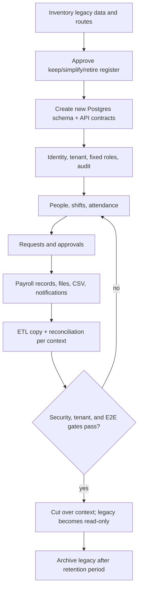

# Rewrite Plan: SvelteKit + Rust

## Product boundary

The target is full Laravel capability parity in Rust and Svelte. Workforce flows are being implemented first; commercial, accounting, collaboration and the remaining legacy modules still require implementation. See FEATURE_REGISTER.md for the expanded scope. The rewrite is not ready for production cutover.

### Migrate and simplify

- Identity, company, branch, fixed roles: `owner`, `admin`, `manager`, `employee`
- Employee directory and direct-manager hierarchy
- Shift, schedule, attendance check-in/out with GPS, photo, and short-lived QR
- One request flow for leave, overtime, and attendance correction
- Sequential manager/admin approvals
- Basic monthly payroll records and read-only payslips
- Private files, notification inbox, immutable audit events, CSV import/export

### Remaining parity work (not retired)

- POS, CRM, accounting, operations, collaboration, custom forms
- Enterprise licensing/obfuscation, backup UI, configurable RBAC builder
- Face ID, liveness, complex risk scoring, anti-mock engine, offline sync
- KPI/appraisal, assets, HR document generation/checklist automation
- Shift swap, WFH, advanced payroll tax/bank/Coretax, PDF/XLSX report center

## Target architecture

- **Web:** SvelteKit PWA, mobile-first.
- **Backend:** Rust modular monolith: Axum + SQLx + PostgreSQL.
- **Async:** Postgres outbox + worker. No Redis or WebSocket requirement for core flows.
- **Files:** private S3/R2-compatible storage; tenant-prefixed object keys.
- **Edge:** Cloudflare for DNS, WAF, cache, and static delivery; not the main Rust runtime.

```text
apps/web                 SvelteKit
apps/api                 Axum HTTP adapter
apps/worker              outbox, email, exports
crates/domain            entities, value objects, invariants
crates/application       use cases and ports
crates/adapters          Postgres, storage, email
crates/contracts         OpenAPI types
```

Rules: every company-owned write model has non-null `company_id`; the authenticated token supplies actor and company context; no client can submit a company ID; all repository queries are company-scoped; sensitive mutations generate audit events.

## Agent lanes

| Lane | Owns | Output gate |
| --- | --- | --- |
| Product-scope | keep/simplify/retire register | no unapproved feature enters v1 |
| Data-migration | legacy inventory, ETL, reconciliation | count, FK, balance checks pass |
| Rust-core | identity, tenancy, RBAC, audit, API contracts | tenant-isolation and authorization tests pass |
| Rust-time | people, schedule, attendance, QR | check-in/out end-to-end passes |
| Rust-requests | request state machine and approvals | submit/approve/reject tests pass |
| Svelte-web | app shell and task-based screens | E2E core journeys pass |
| Security/QA | threat model, dependency and migration gates | no critical auth/isolation finding |

## Skills used by each lane

- Rust-core/time/requests: `architecture-patterns`, `auth-implementation-patterns`, `postgresql-table-design`, `rust-review`.
- Svelte-web: `frontend-design`, `responsive-design`, `accessibility-compliance`.
- Data-migration: `database-migration`, `data-quality-frameworks`.
- Security/QA: `security-requirement-extraction`, `qa-test-planner`, `e2e-testing-patterns`.

## Delivery flow



## Build order

1. Contract and schema: OpenAPI, tenant model, role presets, audit event schema.
2. Login and app shell: `/login`, `/app/today`, role-aware navigation.
3. Employee + attendance: employee, shift, location/QR, check-in/out, history.
4. Requests + approval: one request inbox and one approval inbox.
5. Admin: employees, attendance, settings, CSV.
6. Payroll/history migration, reconciliation, then staged cutover.

## Non-negotiable acceptance tests

1. Employee logs in, checks in/out, and sees history.
2. Employee submits a request; manager approves/rejects it.
3. Admin creates employee, shift, and location/QR.
4. Tenant A cannot read or mutate tenant B data.
5. Every sensitive mutation has an audit event.

## Implemented baseline

- `0001_identity.sql` defines companies, users, fixed-role memberships, hashed sessions, and audit events.
- API startup only connects to the dedicated rewrite database. Run migrations explicitly with `cargo run -p paspapan-api --bin migrate`.
- UUIDs are generated by the application; every tenant-owned record starts with a non-null `company_id`.
## Local runtime

Use a dedicated PostgreSQL database. The rewrite deliberately does not reuse the Laravel database or run migrations during API boot.

```sh
cp guides/rewrite/.env.example .env.rewrite
# Edit DATABASE_URL for a dedicated, empty PostgreSQL database.
set -a; source .env.rewrite; set +a
cargo run -p paspapan-api --bin migrate
cargo run -p paspapan-api --bin paspapan-api
```

The first migration establishes identity, company membership, hashed session storage, and audit-event tables. Keep the Laravel installation read-only until the later ETL/reconciliation phase.

In another terminal, start the web app:

```sh
cd apps/web
bun install
bun run dev
```

Open `http://127.0.0.1:4173/login`. Port `4173` is reserved for the rewrite so it cannot be confused with the Laravel Vite server. For a clean local database, register the first owner with the API once, then use that account in the login page:

```sh
curl -i \
  -H 'Origin: http://127.0.0.1:4173' \
  -H 'content-type: application/json' \
  --data '{"company_name":"Demo","company_slug":"demo","full_name":"Admin Demo","email":"admin@example.test","password":"local-demo-password"}' \
  http://127.0.0.1:3000/v1/auth/register
```

Use the browser for the remaining smoke path: sign in → `/app/today` → allow location → check-in → check-out. Owners and admins can open `/admin/attendance` to create shifts and assign them. The API requires `APP_ORIGIN` on every mutating request; this is intentional CSRF protection.

